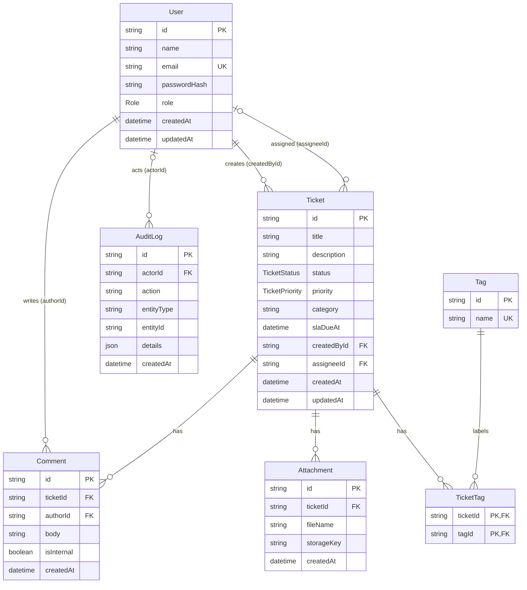

# SupportDesk ERD

Entity Relationship Diagram for the SupportDesk database.
Source of truth: `apps/api/prisma/schema.prisma`.

## Relationships

| Relationship | Cardinality | Delete behaviour |
|---|---|---|
| User creates Ticket (`createdById`) | 1 : N, required | Restrict |
| User is assigned Ticket (`assigneeId`) | 1 : N, optional | Set null |
| Ticket has Comment | 1 : N | Cascade |
| User writes Comment (`authorId`) | 1 : N | Restrict |
| Ticket has Attachment | 1 : N | Cascade |
| Ticket and Tag | M : N through `TicketTag` | Cascade on the join rows |
| User acts in AuditLog (`actorId`) | 1 : N, optional | Set null |

## Enums

| Enum | Values |
|---|---|
| Role | customer, agent, admin |
| TicketStatus | open, in_progress, waiting_on_customer, resolved, closed |
| TicketPriority | P1, P2, P3, P4 |

## Indexes

| Model | Index |
|---|---|
| Ticket | `status`; `assigneeId, status`; `createdById` |
| Comment | `ticketId, createdAt` |
| TicketTag | `tagId` (the primary key already covers `ticketId`) |
| Attachment | `ticketId` |
| AuditLog | `entityType, entityId` |
